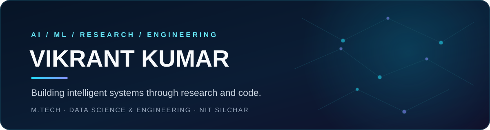

### AI/ML Engineer · Deep Learning Researcher · Software Developer

**M.Tech in Data Science & Engineering — NIT Silchar**

[Portfolio](https://vikrant-portfolio-chi.vercel.app/) · [LinkedIn](https://www.linkedin.com/in/vikrant-kumar11022003/) · [GitHub](https://github.com/Myths-calm42)

About
I build practical intelligent systems at the intersection of machine learning, medical imaging, generative AI, and software engineering. I enjoy moving from research questions and model experiments to tested implementations and usable applications.
- 🔬 Research: Medical image analysis, breast ultrasound classification, morphology-guided Mixture-of-Experts.
- 🧠 AI: Deep learning, computer vision, transfer learning, LLM fine-tuning, and RAG.
- ⚙️ Systems: C++, operating systems, multicore CPU scheduling, affinity, and load balancing.
- 🛠️ Engineering: Python, FastAPI, Next.js, React, databases, and deployment.
Tech I work with

Languages

AI / Data

Development & Tools

Featured work
<table>
<tr>
<td width="50%" valign="top">📊 Financial Market Analytics
Full-stack market analytics and forecasting platform with ML models, backtesting, sentiment analysis, authentication, and a persistent watchlist feedback workflow.

Python FastAPI Next.js ML

View repository →
</td>
<td width="50%" valign="top">🫁 Lung Cancer Classification
CT-image classification research using transfer learning, CNN architectures, and image-processing workflows for normal, benign, and malignant classes.

Python TensorFlow CNN OpenCV

View repository →
</td>
</tr>
<tr>
<td width="50%" valign="top">⚙️ Multicore SMP CPU Scheduler
C++ simulator covering scheduling algorithms, CPU affinity, process migration, migration overhead, and load balancing.

C++17 Operating Systems SMP

View repository →
</td>
<td width="50%" valign="top">🧬 QLoRA Story Continuation
Parameter-efficient LLM fine-tuning workflow for long-form story continuation, evaluation, and deployment experiments.

Python Transformers QLoRA

View repository →
</td>
</tr>
<tr>
<td width="50%" valign="top">📚 StoryGen-RAG
Long-form story continuation using retrieval-augmented generation to support context retention and coherent generation.

Python RAG Embeddings LLMs

View repository →
</td>
<td width="50%" valign="top">🌐 Personal Portfolio
A personal website presenting technical skills, projects, research interests, and professional experience.

JavaScript React Web

Repository → · Live site →
</td>
</tr>
</table>Research
Morphology-Guided Mixture-of-Experts for Breast Ultrasound Classification
Exploring complementary image representations through four expert branches:
Expert branch	Image representation
Texture	CLAHE-enhanced image
Shape	Gaussian-blurred image
Boundary	Canny–Sobel edge composite
ROI	Otsu-based region of interest

Research milestones
- 🎓 Accepted — ICISS 2027: Disagreement-Aware Multi-Branch Mixture-of-Experts for Breast Ultrasound Classification: A Morphology-Guided Backbone Ablation Study.
- 📝 Journal submission: Morphology-Guided Mixture-of-Experts for Breast Ultrasound Classification: From Single-Backbone to Hybrid CNN Fusion — submitted to Medical Image Analysis (Elsevier).
Beyond the code
- M.Tech: Data Science & Engineering, NIT Silchar.
- B.Tech: Computer Science & Engineering, Assam University, Silchar.
- Workshop: Volunteer and session contributor at the ANRF-sponsored workshop Biomedical Applications Using Deep Learning Techniques, NIT Silchar (June 2026).
Currently exploring
LLMs · RAG · AI Agents · PEFT / QLoRA · Medical Imaging · MONAI · Quantum–Classical ML · Systems Programming
GitHub activity
Rather than relying on third-party statistics images that can disappear or hit rate limits, this profile uses GitHub's own contribution graph and repository activity. You can explore the live data here:

GitHub's native contribution calendar is displayed directly below the profile README on your Overview page.
Let's connect
If you're interested in applied AI, medical imaging, LLM applications, research collaboration, or software engineering, feel free to connect.

Thanks for stopping by. Let's build something meaningful.

